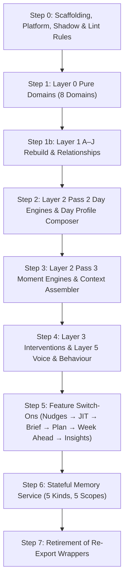

# October Shadow Work: Comprehensive Implementation Blueprint & Engineering Verification

**Date:** 23 October 2026  
**Author:** Manoj Kumar  
**Audience:** Shukrita Puri (@SPur) & Engineering  
**Specification Base:** `/Users/manojkumar/Downloads/October Shadow Work 2/`  
**Status:** Implementation Blueprint (Pre-Implementation Verification & Phasing)

---

## 1. Inventory & Verification of Specification Files

All files in `/Users/manojkumar/Downloads/October Shadow Work 2/` have been audited. Every required document across all 4 parts is present and verified:

| Part | Folder / File | Status | Description |
| :--- | :--- | :--- | :--- |
| **Part 1** | `1- PART 1 - Knowledge Spine & Memory Spine/.../Knowledge_and_Memory_Spine_Final-2.md` | **Present** | Knowledge & Memory Spine specification, decisions, and consolidation map. |
| **Part 2** | `2- PART 2 - LAYERS/2a- Layer 0- Connectors/Part2_Layer0_Sources_and_Connectors.md` | **Present** | Layer 0 sources, connectors, and 8 domain specifications. |
| **Part 2** | `2- PART 2 - LAYERS/2b- Layer 1 · Demand (A–J)/1_ FINAL DOCUMENT TO USE- A–J Event Classification Final Design.md` | **Present** | Canonical A–J 5-step classification design. |
| **Part 2** | `2- PART 2 - LAYERS/2b- Layer 1 · Demand (A–J)/2_ Part2_Layer1_Demand_AJ_and_Relationships-2.md` | **Present** | Layer 1 demand dimensions and relationship engine specification. |
| **Part 2** | `2- PART 2 - LAYERS/2b- Layer 1 · Demand (A–J)/3- Calendar Event Labelling and Learning/UPDATED -shukrita_real_calendar_events_labelled.csv` | **Present** | 71 real calendar rows hand-labeled with gold categories, subtypes, and notes. |
| **Part 2** | `2- PART 2 - LAYERS/2c- Layer 2_ Context.../1_ Part2_Layer2_Context-2.md` | **Present** | Pass 2 (Day) and Pass 3 (Moment) decision engines & composers. |
| **Part 2** | `2- PART 2 - LAYERS/2c- Layer 2_ Context.../2_ A4_commit1_plan_loads_goals.patch` | **Present** | Plan loads and goals patch. |
| **Part 2** | `2- PART 2 - LAYERS/2c- Layer 2_ Context.../3_ A4_release_note.md` | **Present** | Release notes for A4. |
| **Part 2** | `2- PART 2 - LAYERS/2c- Layer 2_ Context.../4_ A4_commit2_goal_map_and_tests.patch` | **Present** | Goal map and tests patch. |
| **Part 2** | `2- PART 2 - LAYERS/2c- Layer 2_ Context.../5_ Part2_Review_Log_v3.md` | **Present** | Review log. |
| **Part 2** | `2- PART 2 - LAYERS/2f- Layer 3- Intervention/1_ Part2_Layer3_Interventions.md` | **Present** | Layer 3 Intervention engine (E2 Need, E3 Route, E4 Compose) & 5-stage selector. |
| **Part 2** | `2- PART 2 - LAYERS/2f- Layer 3- Intervention/2_ Layer3_practice_catalogue.json` | **Present** | Database seed catalog for practices. |
| **Part 2** | `2- PART 2 - LAYERS/2f- Layer 3- Intervention/3_ Layer3_catalogue_tags_migration.sql` | **Present** | SQL migration for practice catalog tags. |
| **Part 2** | `2- PART 2 - LAYERS/2e- Layer 5- Chief Of Staff Voice.../Part2_Layer5_Voice_and_Behaviour-2.md` | **Present** | Layer 5 SIG (behaviours), GRD (guardrails), and VOC (voice contract). |
| **Part 2** | `2_ _IMPORTANT_ Part2_MANOJ Very Important- Implementation_Note_Engines.md` | **Present** | The 10 rules for every engine, done criteria, shortcuts to avoid, and checks. |
| **Part 3** | `3- PART 3 - App Features & Its Edge Functions/Part3_Features.md` | **Present** | App features, feature-owned files, and edge function specifications. |
| **Part 4** | `4- PART 4 - Folder Structure/FINAL - Part2_Shadow_Structure_Folder_Tree.md` | **Present** | Approved tree, 19 changes (C1–C19), file-to-folder map, and build order. |

> [!NOTE]
> **Pending from Shukrita:** Layer 4 (`patterns/` deep specs) is pending as noted in her message. Until Layer 4 arrives, Layer 3 ranks practices without efficacy patterns, which its rules explicitly accommodate (Rule R7).

---

## 2. Answers to Specific Technical Checks

### Check 1: Load-Shape Labels (`load-shape/labels.ts`)
* **Finding:** `load-shape/labels.ts` defines user-facing copy functions (`shapeLabel`, `shapeTooltip`, `shapeInsightSentence`, `shapeQualifier`, `briefShapeSentence`).
* **Verdict:** Per C14 and Layer 5 Section 10, **`load-shape/labels.ts` moves to `domains/voice/`**, while the mathematical density and mode-switching calculations (`classify.ts`, `modes.ts`, `read.ts`, `types.ts`) move to `domains/load/` and `domains/mix/`.

### Check 2: `_probe.ts` Callers
* **Finding:** An exhaustive search across `supabase/` and `src/` revealed **zero callers** for `supabase/functions/_shared/_probe.ts`.
* **Verdict:** It is a standalone scratch test script that directly calls `behaviour-evaluator.ts`. It has no live dependencies and will remain quarantined or retired.

### Check 3: Live Edge Functions Calling Claude Directly (Bypassing the Writing Switch)
* **Finding:** A codebase-wide audit confirmed that **9 edge functions** call `https://api.anthropic.com/v1/messages` directly via `frozenAwareFetch` without routing through `anthropic.ts` or the platform model register:
  1. `supabase/functions/detect-recurring-patterns/index.ts` (line 77)
  2. `supabase/functions/extract-tool-commitments/index.ts` (line 97)
  3. `supabase/functions/detect-coach-scenarios/index.ts` (line 92)
  4. `supabase/functions/extract-coach-insights/index.ts` (line 152)
  5. `supabase/functions/dialogue-session-manage/index.ts` (line 505)
  6. `supabase/functions/resolve-session-commitments/index.ts` (line 83)
  7. `supabase/functions/analyze-probing-effectiveness/index.ts` (line 88)
  8. `supabase/functions/process-orphaned-sessions/index.ts` (line 217)
  9. `supabase/functions/generate-coach-summary/index.ts` (lines 108, 344)
* **Verdict:** These calls will be routed through `_shared/platform/models.ts` and `anthropic.ts` writing provider switch, ensuring platform-wide governance.

### Check 4: Why 23 of 39 Event Kinds in the Export Had Zero Attendees
* **Root Cause Discovered in `scripts/export-calendar-events-for-labeling.ts` (line 50):**
  ```typescript
  const rawAttendees = Array.isArray(evt.attendees) ? evt.attendees : [];
  ```
  The table `calendar_events` does **not** have a top-level column named `attendees`. Attendees are stored inside `event_metadata -> attendeeSignals` and `event_metadata -> attendees`. Because the export script read `evt.attendees`, it evaluated to `undefined`, defaulting to an empty list `[]` for every event where attendees were only present in `event_metadata`.
* **Verdict:** The calendar sync ingest pipeline (`sync-calendar`) *is* extracting attendees and storing them in `event_metadata`. The export script had a schema lookup bug.

### Check 5: Where the 13 Duplicate Events in the Export Came From
* **Root Cause Discovered in `scripts/export-calendar-events-for-labeling.ts` (lines 40–45):**
  The script queried the raw `calendar_events` table directly via:
  ```typescript
  supabase.from("calendar_events").select(...).eq("user_id", userId)...
  ```
  It bypassed `primary_calendar_events` and `calendar-merge.ts`.
  When a recurring Google calendar event is synced, Google provides both series master instances and individual occurrences; similarly, events linked across multiple accounts (e.g. personal Gmail + work Google Workspace) create multiple rows in `calendar_events`.
  Without applying `DISTINCT ON (identity_key)` or `mergeCalendarEvents()`, raw calendar duplicates were emitted directly into the CSV.
* **Verdict:** Deduplication must always run through `domains/calendar/` (`mergeCalendarEvents()`).

---

## 3. Function-Level Map for Split Files (C14 Compliance)

Per Rule C14, files that split across multiple domains must be re-exported by function name to avoid namespace collisions.

| Original File in `_shared/` | Functions / Elements | Target Domain | Action |
| :--- | :--- | :--- | :--- |
| `rules/calendarEvents.ts` | `mergeCalendarEvents`, `eventOverlapsDay`, `isMultiDayEvent`, `normalizeEventTimes` | `domains/calendar/` | Re-exported from `calendar/` |
| | `scoreImportance`, `rankByImportance`, `pickNextUp`, `selectLeadEvent` | `domains/importance/` | Retired into `importance/` |
| `calendar-provider.ts` | `PROVIDER_PRIORITY`, provider constants, provider validation | `domains/calendar/` | Re-exported from `calendar/` |
| | `getPrimaryCalendarEvents`, table query functions | *Adapters / Context* | Stays in adapter / `context/queries.ts` |
| `rules/google-calendar-errors.ts`, `microsoft-calendar-errors.ts`, `rules/sync-calendar-token-outcome.ts`, `rules/calendar-quota-scope.ts`, `rules/calendar-connection-state.ts`, `rules/normalize-watch-status.ts` | Error parsers, token outcomes, quota trackers, connection health | `domains/capabilities/` | Re-exported from `capabilities/` |
| `rules/microsoft-graph-subscription.ts` | Pure lifetime calculation (`computeSubscriptionExpiration`, payload builders) | `domains/capabilities/` | Re-exported from `capabilities/` |
| | Network fetch calls (`POST /subscriptions`, `PATCH /subscriptions`) | *Adapters* | Stays in `register-calendar-watch` |
| `connection-recovery.ts` | State machine rules, reconnect eligibility decisions | `domains/capabilities/` | Re-exported from `capabilities/` |
| | Database mutation queries (`update connection_status`) | *Adapters* | Stays in edge function |
| `calendar-token-refresh.ts` | Expiry thresholds, refresh window decision rules | `domains/capabilities/` | Re-exported from `capabilities/` |
| | Supabase RPC calls (`store_oura_access_token`, vault operations) | *Adapters* | Stays in edge function |
| `travel/travel-day.ts` | `haversineDistance`, `isFarFromHome`, `latestFix` | `domains/location/` | Re-exported from `location/` |
| | `deriveTravelFacts`, `isTravelDay` | `domains/travel/` | Re-exported from `travel/` |
| `availability/light-day.ts` | `classifyLightDay`, density evaluation | `domains/load/` | Re-exported from `load/` |
| | `isLastDayOfLongWeekend`, run position evaluation | `domains/availability/` | Re-exported from `availability/` |
| | Cadence push trigger helpers | `domains/guardrails/` | Re-exported from `guardrails/` |
| `brief/day-shape.ts` | Meeting density calculation, duration totals | `domains/load/` | Re-exported from `load/` |
| | Context switching count, back-to-back chaining | `domains/mix/` | Re-exported from `mix/` |
| | Ad-hoc day typing logic | `domains/day-profile/` | Retired into `day-profile/` |
| `jit/select-jit.ts` | Importance scoring algorithm, anchor weights | `domains/importance/` | Re-exported from `importance/` |
| | JIT candidate candidate filtering & slot allocation | `supabase/functions/generate-mastery-plan/` | Stays in Plan feature |
| `nudges/event-phase.ts` | `resolveEventPhase`, `minutesUntil`, `minutesRemaining`, `isFullDayArc` | `domains/phase/` | Re-exported from `phase/` |
| | `phaseClause`, `validateEventPhaseInCopy` | `domains/voice/` | Re-exported from `voice/` |
| `load-shape/labels.ts` & `load-shape/surfaces.ts` | `shapeLabel`, `shapeTooltip`, `shapeInsightSentence`, `briefShapeSentence` | `domains/voice/` | Re-exported from `voice/` |
| | Quantitative thresholds, density evaluation | `domains/load/` & `domains/mix/` | Re-exported from `load/` & `mix/` |
| `patterns/pattern-eligibility.ts` | Gate evaluation, freshness checks | `domains/guardrails/` | Re-exported from `guardrails/` |
| | `composePatternSentence` | `domains/voice/` | Re-exported from `voice/` |
| `brief-signal-coverage.ts` | Conference signal detection rules | `domains/conference/` | Re-exported from `conference/` |
| | Brief card coverage verification | `supabase/functions/brief-by-id/` | Stays in Brief feature |
| `signal-engine/*context.ts` (morning, afternoon, evening) | Window determination, quiet hours | `domains/window-mode/` | Re-exported from `window-mode/` |
| | Horizon lookahead and lookback | `domains/horizons/` | Re-exported from `horizons/` |
| | Remaining day demands | `domains/remaining/` | Re-exported from `remaining/` |
| | Database fetch queries | `domains/context/queries.ts` | Consolidated in `context/` |
| `ceo-behaviour/*` | Rule functions (`denseDayMode`, `vetoRisk`, `maskedFatigue`) | `domains/behaviours/steps/` | Re-exported from `behaviours/` |
| | Delivery caps, quiet hours, cooldowns | `domains/guardrails/` | Re-exported from `guardrails/` |
| | CEO thresholds, specific terminology | `_shared/audiences/ceo/` | Re-exported from `audiences/ceo/` |
| | Copy hints & narrative suggestions | `supabase/functions/brief-by-id/` | Stays in Brief feature |

---

## 4. Endorsement of Changes C1–C19 (No Objections)

Engineering has reviewed all 19 changes against the codebase and **fully endorses all 19**:
1. **C1 (`interventions/`):** Layer 3 name aligns with the database catalog seed (`Layer3_practice_catalogue.json`). Removing hardcoded code manifests prevents two conflicting sources of truth.
2. **C2 (8 Layer 0 Domains):** Adding `profile/`, `engagement/`, `capabilities/`, and `public-lookup/` creates clean modular boundaries.
3. **C3 (`capabilities/`):** Fencing connection health, retry jitter, and error parsers into `capabilities/` keeps `calendar/` purely focused on canonical item parsing.
4. **C4 (Pure Inside, Adapters Outside):** Leaving database mutations (`atomic-upsert.ts`) in edge functions protects domain purity.
5. **C5 & C6 (`relationships/` & `spine/`):** Establishing `spine/` as the single shared registry for versioned vocabularies eliminates ad-hoc enum divergence.
6. **C7 (Audience CEO Scope):** Limiting roles to executive hierarchy prevents premature student abstractions.
7. **C8 (`open-loops/`):** Storing open loops as a dormant domain behind a flag prevents schema churn.
8. **C9 (`events/event-phase-map.ts` to `interventions/catalogue/`):** Correctly places the coaching intervention map in Layer 3.
9. **C10 (Window Builder Field Distribution):** Distributes window facts to pure engines, isolating DB queries in `context/queries.ts`.
10. **C11 (`ceo-behaviour/` 3-Question Split):** Systematically distributes facts, signals, guardrails, and copy.
11. **C12 (Feature Isolation in `_shared/brief/`, `plan/`, `jit/`):** Keeps feature narratives and slot allocators with features, enforced by linting.
12. **C13 (JIT vs. Importance):** Decouples general importance scoring from Plan JIT slot placement.
13. **C14 (Named Re-Exports for Split Files):** Eliminates import breakages across existing edge functions.
14. **C15 (A–J Rebuild from Final Design):** Rebuilding Layer 1 from scratch with 5 finding steps rather than copying keyword-heavy v3 code ensures high accuracy.
15. **C16 (Early Shadow Validation):** Running domains in shadow prior to feature switch-on provides safe, verifiable rollout.
16. **C17 (`platform/models.ts`):** Establishes platform-level model governance.
17. **C18 (Standard File Convention):** Every domain consistently has `index.ts`, `types.ts`, `constants.ts`, `steps/`, and tests.
18. **C19 (Comprehensive 183-File Coverage):** Ensures zero untracked files remain in `_shared/`.

---

## 5. Sequential Build Order & Verification Plan



### Step 0 · Scaffolding & Governance
* Set up `_shared/spine/` (shared vocabularies), `_shared/platform/` (`models.ts`), `_shared/shadow/` (runners and difference classifiers), and `_shared/audiences/ceo/`.
* Configure lint rules:
  1. No domain imports from `_shared/brief/`, `_shared/plan/`, `_shared/jit/`, or `_shared/nudges/`.
  2. Database client may only be imported inside `domains/context/` and `domains/memory/`.
  3. No title checks (`.title.includes(...)`) permitted outside Layer 1 Step 2.1.
  4. Barrels enforced: nothing imports past a domain's `index.ts`.

### Step 1 · Layer 0 Pure Domains (Behind `L0_PARSERS_DOMAIN`)
* Build pure domains: `calendar/`, `wearable/`, `profile/`, `checkins/`, `location/`, `engagement/`, `capabilities/`, `public-lookup/`.
* Replace old files with named re-exports.
* **Gate:** 100% identical canonical output on recorded fixtures and live traffic.

### Step 1b · Layer 1 Rebuild: A–J Event Classifier & Relationships
* Rebuild `domains/events/` strictly from *A–J Event Classification Final Design* implementing all 5 finding steps:
  1. *Step 1: Parse & Sanitization*
  2. *Step 2.1: Title intent cues* (Weak signals only, no instant winners)
  3. *Step 2.2: People & Attendees* (Resolving user-role, attendee counts, internal vs external)
  4. *Step 2.3: Relationships & Organization Type* (User context, verified relationships)
  5. *Step 2.4: Place & Modality* (In-person, virtual, offsite, stage vs meeting room)
  6. *Step 2.5: Time & Recurrence* (Duration, cadence, time of day)
  7. *Step 3.1: Scoring by Signature* (Evaluating findings against 7.2 signatures)
  8. *Step 3.2: Cross-checks* (All 8 cross-checks: travel, content vs room, stage vs seat, prep vs meeting, etc.)
  9. *Step 3.3: Confidence & Evidence Families*
  10. *Step 3.4: LLM Read of Findings* (For ambiguous edge cases, reading structured findings rather than titles)
* Build `domains/relationships/` for attendee role classification.
* **Gate:** Validate against Shukrita's labeled real calendar events (`UPDATED -shukrita_real_calendar_events_labelled.csv`). Achieve $\ge 85\%$ accuracy on Golden Set and $\ge 95\%$ on Holdout Set.

### Step 2 · Layer 2 Pass 2: Understand the Day (`SPINE_DAY_PROFILE=shadow`)
* Build pure day engines: `time/`, `availability/`, `travel/`, `conference/`, `load/`, `mix/`, `crisis/`, `week-ahead/`, `open-loops/` (off), `importance/` (base), and `day-profile/` (Day Profile Composer).
* **Gate:** Pass all 56 baseline scenarios (including in-town conference and Oxford weekend) without error.

### Step 3 · Layer 2 Pass 3: Understand the Moment (`SPINE_READ=shadow`)
* Build pure moment engines: `physiology/`, `self-report/`, `agreement/`, `fit/`, `trajectory/`, `state-profile/`, `importance/` (window adjustment), `window-mode/`, `phase/`, `remaining/`, `horizons/`, `window-profile/`, and `gate/`.
* Build `domains/context/` assembler executing batched parallel queries to construct the immutable `ContextBundle`.
* Wire `domains/memory/` reads (Tier 0 to Tier 3).
* **Gate:** Field-by-field parity between existing context snapshots and the new ContextBundle.

### Step 4 · Layers 3 & 5: Interventions & Chief of Staff Voice
* Build `domains/interventions/` (`engine/`, `selector/`, `catalogue/`).
* Build Layer 5 pure domains: `domains/behaviours/` (SIG signals), `domains/guardrails/` (GRD verdicts), `domains/voice/` (VOC copy contracts & lexicon).
* **Gate:** Layer 3 selection criteria and Layer 5 guardrail parity running in shadow.

### Step 5 · Progressive Feature Switch-Ons
* Switch features one at a time via environment flags:
  1. `SPINE_NUDGES=on`
  2. `SPINE_JIT=on`
  3. `SPINE_BRIEF=on`
  4. `SPINE_PLAN=on`
  5. `SPINE_WEEK_AHEAD=on`
  6. `SPINE_INSIGHTS=on`
* **Gate:** Promotion checks pass with zero rollbacks.

### Step 6 · Shared Memory Service Writes (`SPINE_MEMORY=on`)
* Enable shared memory mutations via `domains/memory/` (5 memory kinds, 5 correction scopes) with cryptographic provenance stamping.

### Step 7 · Decommissioning & Cleanup
* Following 14 days of stable 100% production traffic on the spine, safely delete all one-line re-export wrappers.

---

## 6. Implementation Commitment

Engineering commits to:
1. **Zero Shortcuts:** Every engine will be implemented with all its specified inputs, ordered steps, and signature scoring.
2. **Zero Code Duplication:** No simple copying of legacy keyword checks.
3. **Strict Gate Proofs:** Every layer will be verified with raw unedited test output, diffs, and real-data shadow logs before moving to the next step.
